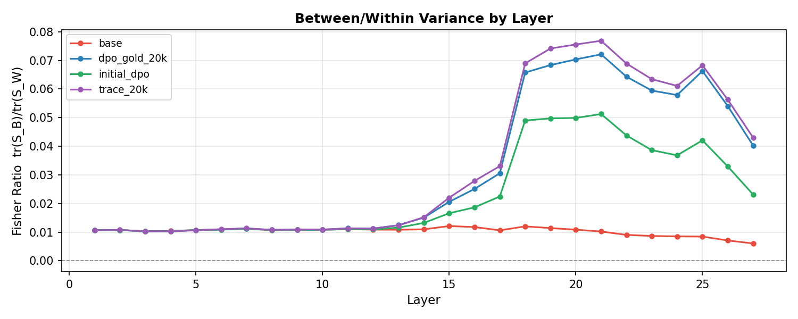
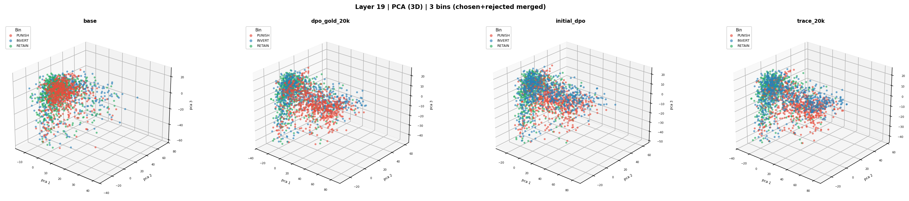
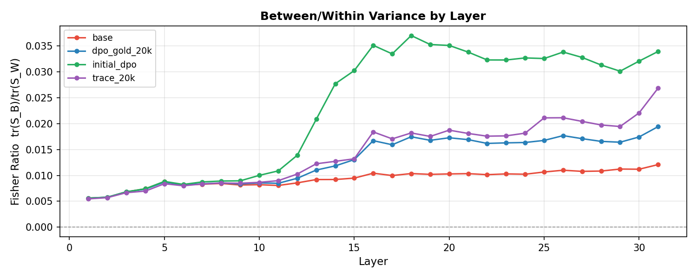
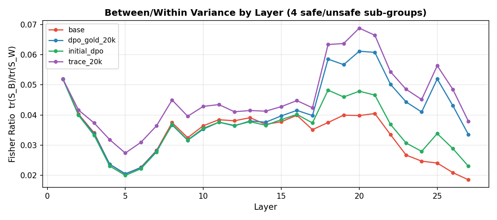
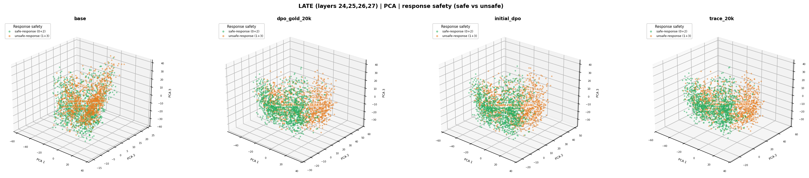

+++
title = 'TRACE: The Realignment Problem'
aliases = ['/projects/trace/']
date = 2026-10-21T12:00:00+05:30
draft = false
+++

### TRACE: The Realignment Problem — When Right Becomes Wrong in LLMs

Alignment isn't a one-time thing. The rules a model gets aligned to (safety policies, content guidelines, what counts as "acceptable") keep changing, but the model stays frozen at whatever it was trained on. We call this drift the **Alignment-Reality Gap**: a model that was "right" under the old policy becomes "wrong" under the new one. The obvious fix is to re-annotate the preference data under the revised rules and retrain, but that is expensive, slow and inconsistent. So the question we asked was: can you realign a model to a new policy by reusing the preference data you already have?

That's what **TRACE** (*Triage and Re-align by Alignment Conflict Evaluation*) does. It first triages the existing preference pairs against the new policy, using a stronger model as a proxy judge. Each pair is sorted into one of three buckets: **inversion** (the old preferred answer is now the wrong one), **suppression** (both answers are now unacceptable), or **retention** (still fine as is). A bi-level optimization then scores how much each sample matters, and the model is updated with a hybrid objective: IPO for inversions and NPO for suppressions, while the retained data keeps general capabilities intact. We tested it on Qwen2.5-7B, Gemma-2-9B and Llama-3.1-8B, on synthetic policy-shift benchmarks and on PKU-SafeRLHF. In both settings it realigned the models to the new policy without hurting their general utility.

I'm a co-author on this one. My main work was the **experiments** and the **rebuttal**. On the experiments side, that meant running and debugging the training and evaluation pipelines across the different model families and benchmarks, and making sure the comparisons were fair and the numbers held up. The rebuttal was its own experience. Reviewers asked hard questions, and answering them usually meant running new experiments and ablations on a tight deadline, then explaining the results clearly. I learned a lot about how a paper gets defended, not just how it gets written.

---

### My own follow-up: do the policy bins separate inside the model?

After the paper, I wanted to see what TRACE actually changes inside the model. If it treats the triage bins differently, the bins should pull apart in activation space.

I extracted last-token residual-stream activations at every layer for 300 samples per subgroup (Punish / Invert / Retain × chosen / rejected). I did this for four checkpoints of Qwen2.5-7B and Llama-3.1-8B: base, initial DPO, TRACE and DPO trained on gold re-annotated data.

To measure separation I used the Fisher ratio: the spread between group means divided by the spread inside the groups. Higher means the groups are more linearly separable.

#### Qwen: the bins separate after alignment

The base model stays flat at about 0.01 across every layer. The aligned models jump at layer 18 and peak at layer 21, where TRACE (0.077) edges out gold DPO (0.072) and clearly beats initial DPO (0.051).

So the pretrained model doesn't separate the bins. Alignment creates the separation, in the mid-to-late layers.

The PCA shows the same thing. In the base model the bins are one mixed blob. After alignment, Punish (red) gets pushed away from Retain (green). TRACE and gold DPO end up looking almost identical: their CKA similarity at that depth is about 0.99.

#### Llama: same effect, different winner

Llama also separates the bins only after alignment, starting around layer 13. But here initial DPO separates the bins the most, peaking at 0.037. TRACE (0.027) and gold DPO (0.019) come in lower.

Even so, TRACE sits closer to gold DPO than to initial DPO. Initial DPO pulls the bins far apart but also spreads out each bin internally, and TRACE partly undoes that.

#### Safety: TRACE moves where safe vs unsafe is encoded

I ran the same analysis on Qwen with a different grouping: safe prompt + safe response vs harmful prompt + harmful response.

In the base and initial DPO models, safe vs unsafe is separated best at layer 1, the embedding layer. That's mostly a word-level signal.

After TRACE and gold DPO, the peak moves to layer 20, deep in the network. TRACE has the highest peak (0.069, 1.32× over base), above gold DPO (0.061). Initial DPO adds nothing here.

In the late layers (24–27), the safe (green) and unsafe (orange) responses split into two sides after alignment, most clearly for TRACE and gold DPO. Unlike the policy bins, these groups have positive silhouette scores, so the separation holds for individual samples too.

#### Caveats

The policy-bin separation is centroid-level only. Silhouette scores stay negative at every layer, so individual samples still overlap. TRACE moves whole clusters apart without tightening them.

The safe and unsafe sets also differ in topic: the safe set is benign coding and math, the unsafe set is harmful requests. Some of that signal may be topic rather than safety. Next I want to run linear probes per layer and use a topic-matched dataset.

---

- Paper: [arXiv:2511.02623](https://arxiv.org/abs/2511.02623)
- Project page & code: [respailab.github.io/TRACE](https://respailab.github.io/TRACE)
